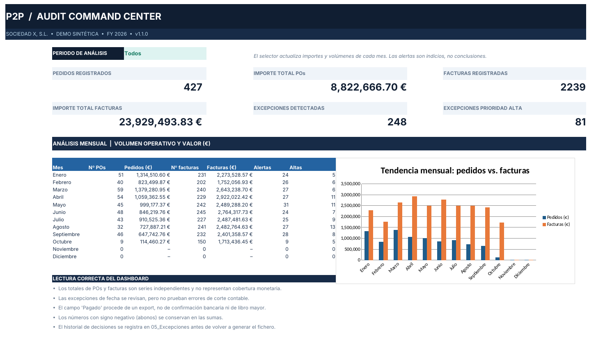

# Purchase-to-Pay Audit Engine

**Controles automatizados del ciclo de compras · Sociedad Ficticia X, S.L. · datos 100 % sintéticos · v1.1**

Motor en Python que concilia pedidos de compra con facturas sobre la población completa, aplica 16 controles de auditoría y genera un libro Excel de 13 hojas con dashboard y registro de excepciones preparado para su documentación como papel de trabajo.

> No es una opinión de auditoría. Cada alerta es una hipótesis de riesgo que requiere evidencia antes de concluir.

**Caso práctico completo:** [ericcardenosa.github.io/#p2p](https://ericcardenosa.github.io/#p2p)



---

## 1. El problema

Los equipos de compras y finanzas trabajan con pedidos de compra (POs), facturas, proyectos y centros de coste que no siempre están correctamente relacionados. Con cientos o miles de documentos, revisar el circuito manualmente tiene un coste alto, y la mera ausencia de una coincidencia puede llevar a conclusiones equivocadas.

Este proyecto reproduce el funcionamiento de un motor de controles de auditoría **con datos totalmente inventados**, sin información de proveedores, clientes o sociedades reales.

## 2. Qué hace

- Reconstruye relaciones **1:N**: un pedido puede tener varias facturas; una factura que cita varias POs se reparte a partes iguales solo con fines analíticos.
- Clasifica diferencias de importe, facturación parcial y POs facturadas en el ERP sin referencia recuperable.
- Examina indicios de duplicidad, coherencia aritmética, fechas y corte, proyectos y centros de coste.
- Genera alertas con **identificador estable**, prioridad, evidencia pendiente y campos de seguimiento.
- Incluye un dashboard filtrable por mes y la evolución gráfica del ejercicio.
- Ejecuta comprobaciones de integridad: recuentos, importes mensuales y ausencia de doble cómputo.

### Resultados de la demostración

| Indicador | Resultado |
|---|---:|
| Pedidos de compra | 427 |
| Facturas | 2.239 |
| POs enlazadas con al menos una factura | 310 |
| Facturas enlazadas con PO válida | 378 |
| POs sin factura explícita enlazada | 117 |
| Alertas de revisión | 248 |
| Alertas de prioridad alta | 81 |
| Pruebas automáticas | 7 (superadas) |

«Facturas sin PO» incluye compras que pueden no requerir orden de compra. Los totales de facturas y de pedidos son series independientes y no representan cobertura monetaria.

## 3. Estructura

```text
p2p-audit-engine/
├── audit_engine.py              # Lectura, motor de controles y exportación a Excel
├── requirements.txt
├── inputs/                      # 4 ficheros sintéticos X_DEMO_*.xlsx
├── output/
│   ├── P2P_AUDIT_2026.xlsx      # Informe de 13 hojas, listo para abrir
│   └── audit_run_summary.json   # Métricas de la ejecución
├── docs/
│   ├── Manual_de_Usuario.pdf    # Manual de 8 páginas
│   └── preview_dashboard.png
└── tests/
    └── test_engine.py           # 7 pruebas de regresión
```

## 4. Instalación y ejecución

Requiere Python 3.10 o superior.

```bash
pip install -r requirements.txt
python audit_engine.py --input-dir inputs --output output/P2P_AUDIT_2026.xlsx
```

Tolerancia en euros (por defecto 1,00 €):

```bash
python audit_engine.py --tolerance 1.00
```

Pruebas automáticas:

```bash
python -m unittest discover -s tests -v
```

El script no modifica los ficheros de entrada. El libro de salida se sobrescribe en cada ejecución.

## 5. Arquitectura

1. **Ingesta**: lectura de los cuatro ficheros y normalización de fechas, importes, referencias y textos.
2. **Indexado**: números de PO, facturas, proyectos y centros de coste válidos.
3. **Cruce**: extracción de la referencia `O######` en la descripción de la factura; relación 1:N con control de doble cómputo.
4. **Motor de reglas**: importes, facturas no localizadas, proyecto y centro de coste, autorización, fechas y duplicidad.
5. **Presentación**: dashboard, detalle por población, registro de excepciones y metodología.
6. **Verificación**: el importe asignado a pedidos se concilia exactamente con las facturas vinculadas; si no cuadra, la ejecución se detiene.

## 6. Cómo leer el informe

- `01_Dashboard`: indicadores y selector de periodo en **D5**.
- `02_Reconciliacion`: una fila por PO con facturas vinculadas, diferencia y estado.
- `03_Facturas` y `04_Pedidos`: poblaciones completas.
- `05_Excepciones`: registro de trabajo con prioridad, control, estado, responsable y conclusión.
- `12_Metodologia`: alcance, criterios y limitaciones.

Los campos de seguimiento son editables. Guarda una copia antes de regenerar el informe.

## 7. Marco de referencia

El diseño se inspira en las Normas Internacionales de Auditoría adaptadas en España: evidencia (NIA-ES 500), respuestas a los riesgos valorados (NIA-ES 330), muestreo (NIA-ES 530, aquí sustituido por el análisis de la población completa) y documentación (NIA-ES 230). Es una referencia orientativa: el proyecto no constituye un trabajo realizado conforme a estas normas.

## 8. Limitaciones

- Se utilizan **exclusivamente ficheros ficticios X_DEMO**.
- «Pagado» es un estado exportado, no una confirmación bancaria.
- No hay extractos bancarios, libro mayor, albaranes, contratos ni aprobaciones con sello temporal.
- Una diferencia entre PO y factura puede justificarse por facturación parcial, suplementos o abonos.
- El reparto de una factura multirreferencia es analítico, no una distribución validada por línea.
- No se aplica materialidad de auditoría; la tolerancia es técnica.

## 9. Historial de versiones

- **v1.1** · Lectura y escritura con `openpyxl` (sustituye a una librería no publicada) y orden determinista de excepciones también en caso de empate.
- **v1.0** · Primera versión: 16 controles, 13 hojas y manual de usuario.

El manual en PDF se redactó para la v1.0; el contenido funcional es el mismo, salvo la dependencia, que ahora es `openpyxl`.

---

### English summary

Python engine that reconciles purchase orders with invoices across the full population, runs 16 audit controls and produces a 13-sheet Excel workbook with a dashboard and an exception log. Built entirely on synthetic data; results are risk indicators, not an audit opinion. Run `pip install -r requirements.txt` and `python audit_engine.py`.

**Autor:** [Eric Cardeñosa Pizarro](https://ericcardenosa.github.io) · [LinkedIn](https://www.linkedin.com/in/ericcardenosapizarro)
